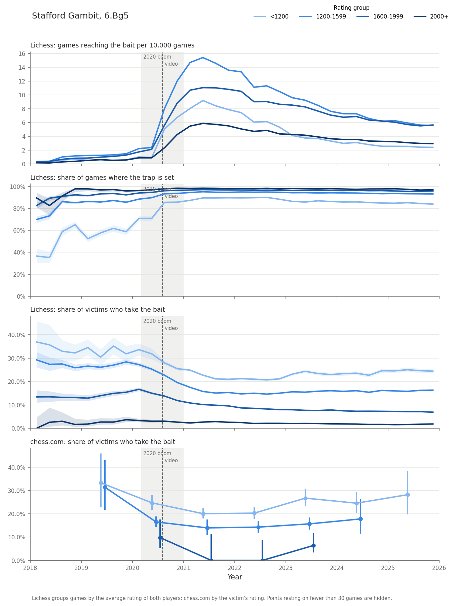
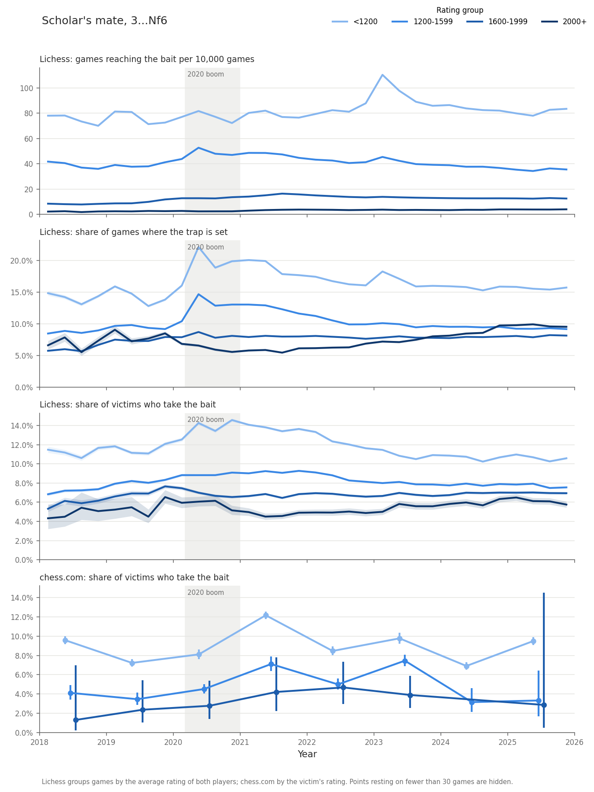

# Do players learn opening traps? Lichess and chess.com, 2018-2025

## What a trap opening is

A trap opening steers the game towards a position where the natural move loses.
The player who sets it, the *setter*, often gives up something to get there: a
pawn in a gambit, or a weak-looking piece. The opponent, the *victim*, sees a
free capture or an obvious reply. If they take it, the setter wins material or
mates at once. If they find the right move, the setter is usually worse off.

The Stafford Gambit is the clearest example: 1.e4 e5 2.Nf3 Nf6 3.Nxe5 Nc6!?
Black gives a pawn. After 4.Nxc6 dxc6 5.d3 Bc5, the natural 6.Bg5, pinning the
knight, loses: 6...Nxe4! and the queen cannot be taken without mate.

## The question

In 2020 the online chess pool grew fast: the lockdowns, then *The Queen's
Gambit*. At the same time, streamers turned some traps into hits. Eric Rosen's
Stafford Gambit video came out on 1 August 2020.

A trap only works on players who don't know it. If a trap becomes famous, the
pool should learn it, and fewer victims should fall for it. This study measures
that, from 2018 to 2025, on both sites.

## How it is measured

For each trap, three things, by quarter and rating group:

- **The entry rate**: where the setter chooses the line, the share of games
  that take it. For the Stafford, the share of 3...Nc6 after 3.Nxe5.
- **The frequency**: games reaching the trap position per 10,000 games. It
  says how often a player meets the trap at all.
- **The fall rate**: among games reaching the trap, the share where the
  victim's reply leaves the setter two pawns up or more, as judged by
  Stockfish 19. It counts every losing reply, not only the textbook one.

All three are proportions, so the growth of the sites does not inflate them.

Lichess numbers come from its opening explorer, which counts every rated game
by position, so they are not a sample. Lichess files a game under the average
rating of both players. chess.com has no such tool: its fall rates come from
about 720,000 trap games found by following setters through their archives,
grouped by the victim's own rating. Its entry rates were read by hand from its
explorer. The [README](../README.md) gives the full method.

## The Stafford Gambit: a wave, then learning

**The trap became fashionable.** On Lichess, the share of players answering
3.Nxe5 with 3...Nc6 went from about 5% in 2018 to over 50% in mid-2021 at
1200-1999. It then fell back and settled around 40% in 2025: still eight
times more than before the video. chess.com shows the same shape, read by
hand: 5% in 2018, 34% in 2021, 19% in 2025.

| Lichess, entry rate | 2018 | 2021 | 2025 |
|---|---|---|---|
| <1200 | 6.0% | 36.7% | 19.9% |
| 1200-1599 | 6.1% | 51.8% | 39.2% |
| 1600-1999 | 4.8% | 51.5% | 41.3% |
| 2000+ | 2.6% | 35.2% | 27.1% |

The frequency follows. At 1200-1599, the trap position appeared in 0.8 games
out of 10,000 in 2018, and in 15 out of 10,000 at the peak in spring 2021.

**Victims learned.** As the trap spread, fewer players fell for it.

| Lichess, fall rate | 2018-19 | 2025 |
|---|---|---|
| <1200 | 33% | 25% |
| 1200-1599 | 27% | 16% |
| 1600-1999 | 14% | 7% |
| 2000+ | 2-3% | 2% |

The drop came in 2020-2021, at the same time as the trap's popularity, and the
fall rate has stayed down since. On chess.com, the 1200-1599 fall rate went
from 22-31% before the video to 13-18% after it, though from fewer than 80
games a year before 2020.

**Three things stand out:**

- **Learning depends on level.** At 1200-1999, the fall rate was roughly
  halved. Above 2000 there was nothing to learn: almost nobody fell for it,
  even in 2018.
- **Under 1200, learning wears off.** The fall rate went down to 21% in 2022,
  then back up to 25% by 2025, on both sites. New beginners keep arriving
  without having seen the video, while the trap has become less common at
  their level. That fits a pool that renews itself, though this study does not
  test it directly.
- **The trap is still played.** Even half as effective, it stayed popular.

## Scholar's mate: nothing to learn

Scholar's mate (1.e4 e5 2.Bc4 Nc6 3.Qh5, aiming at 4.Qxf7#) is the opposite
case. Everyone has known it for a long time. Through 2018-2025:

- **It is common**: 74 to 97 games out of 10,000 under 1200, 35 to 48 at
  1200-1599.
- **It is played as often**: 3.Qh5 is chosen in 14-20% of the games where it
  can be played under 1200, and 9-13% at 1200-1599.
- **It works just as rarely**: 11-14% of victims under 1200 fall, 7-9% at
  1200-1599. On chess.com, 7-12% under 1200.

The 2020 boom brought millions of beginners, and the fall rate under 1200 rose
slightly in 2020-2021 (11% to 14%) before going back to 11%. A well-known trap
leaves nothing for the pool to learn.

## The other traps

Fall rate before the event and from 12 months after it, on Lichess. The event
is the trap's video where there is one, otherwise the start of the 2020 boom.
The months in between are left out. Entry rates cover all ratings.

| Trap | Event | Entry 2018 → 2021 → 2025 | Fall, 1200-1599 | Fall, 1600-1999 |
|---|---|---|---|---|
| Englund, Rosen's trap (2...Bc5) | video, 2020-11 | 6.9% → 22.8% → 14.4% | 58% → 35% | 57% → 25% |
| Englund, 6.Bc3 (1...e5) | 2020 boom | 3.5% → 6.8% → 7.2% | 37% → 22% | 36% → 21% |
| Fishing Pole (4...Ng4) | video, 2021-06 | 2.5% → 1.7% → 0.8% | 31% → 27% | 13% → 11% |
| Blackburne Shilling (3...Nd4) | 2020 boom | 4.7% → 4.7% → 3.6% | 62% → 60% | 54% → 53% |
| Lasker trap (2...e5) | 2020 boom | 4.2% → 4.2% → 3.9% | 54% → 51% | 47% → 44% |
| Caro-Kann smothered mate (5.Qe2) | 2020 boom | 10.0% → 10.2% → 10.2% | 34% → 36% | 15% → 14% |
| Kieninger trap (2...e5) | 2020 boom | 8.2% → 8.2% → 7.3% | 59% → 61% | 39% → 51% |
| Siberian trap (6...Qc7) | 2020 boom | 6.4% → 5.1% → 4.1% | 37% → 46% | 26% → 33% |
| Noah's Ark (5...b5) | 2020 boom | 66.3% → 67.1% → 68.2% | 87% → 86% | 71% → 74% |

- **Rosen's Englund trap** follows the Stafford: a wave after its video, and a
  fall rate divided by two or more at 1200-1999. On chess.com, the classic
  Englund fall rate at 1200-1599 dropped from 47% to 22%.
- **Traps without a video of their own** barely moved, and for the Kieninger
  and the Siberian, victims fell *more* often after 2020. The likely reason is
  the boom itself: at the same rating, the new players were less experienced.
  These traps are rare, so the boom brought new victims rather than knowledge.
- **The Noah's Ark entry, 5...b5, is a standard move** of that line, not a
  choice to set a trap. Its entry rate says nothing about the trap.

Only five traps had enough games on chess.com: Stafford, both Englund lines,
Blackburne Shilling and Scholar's mate. Each trap has its own figure in
[figures/](figures/), and every number is in [tables/](tables/).
